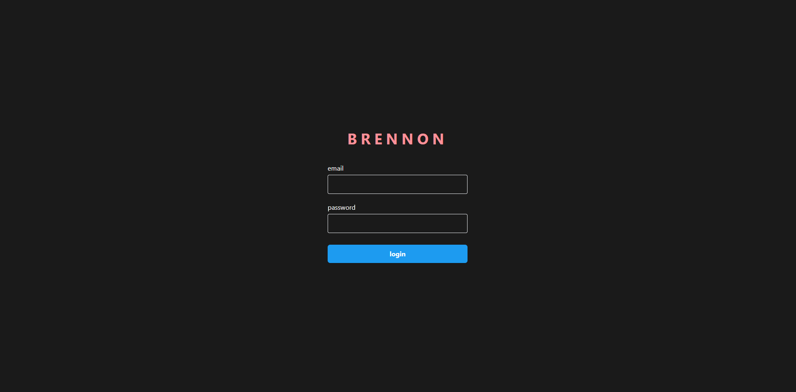
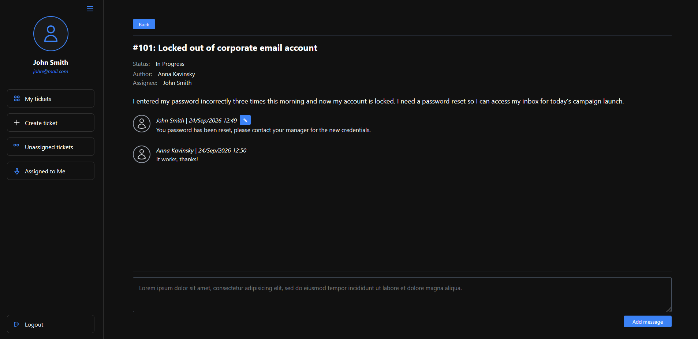
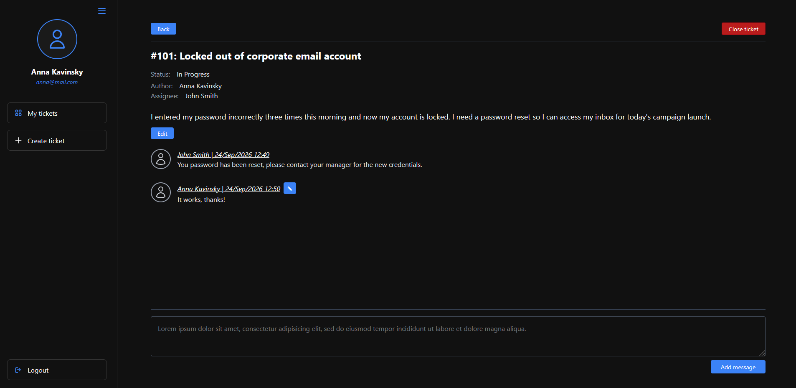
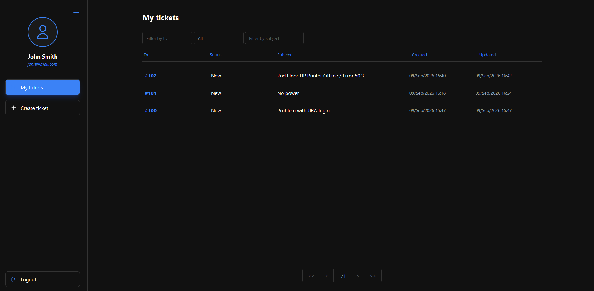

# Brennon

Helpdesk platform









## Project configuration

* Spring Boot 4 + Thymeleaf + Tailwind CSS + HTMX
* Gradle Frontend plugin to execute CSS compilation with `tailwindcss/cli`
* Spring Data Relational + PostgreSQL

**NOTE:** `src/main/resources/static/css/main.css` excluded from Git because it is generated by Tailwind from `styles.css`

**NOTE:** `src/main/resources/static/js/htmx.min.js` included instead of using CDN

### Observability

OTLP is enabled by default. Logging is disabled by default.

```yaml
management:

  metrics:
    tags:
      application: ${spring.application.name}
    export:
      logging:
        enabled: false
        step: "5s"
  otlp:
    metrics:
      export:
        enabled: true
        url: "http://localhost:4318/v1/metrics"
        step: "15s"
```

## Things to note

* [current-user-profile.html](src/main/resources/templates/core/current-user-profile.html) 
    provides a fragment showing user info (name, login, etc) which is used by main layout and
    loaded by HTMX. There is also a dedicated `CurrentUserProfileController` to serve the 
    fragment. Serving fragment via separate controllers allows to re-use them instead of 
    providing the same data (model parameters) in different controllers that use main layout.

* Parametrized Thymeleaf template example, see [sidebar-buttons.html](src/main/resources/templates/fragments/sidebar-buttons.html)

* Custom pages to handle errors. Ex. [404.html](src/main/resources/templates/core/common/404.html). 
    Configures via `ErrorPageRegistrar`, see `ErrorPageConfiguration` and `CustomErrorPageController`

* Form validation (`@NotBlank`, `@ModelAttribute`, etc) automatically uses error messages from `messages.properties`

* Custom converters for Spring Data JDBC, ex `BrennonUserConverters`.
* Spring Data JDBC does not support mapping to Integer for enums, [see here](https://github.com/spring-projects/spring-data-relational/issues/629).
* Spring Data JDBC does not have an option to load referenced aggregate (`AggregateReference<T,ID>`) and that is by design.

* Adding a reply implemented using HTMX, the page is then partially updated using area and fragments selectors. update different parts of the page based on backend response (success or error): use `HX-Retarget` header to override original `hx-target`, see `ticket-details.html`.

* Thymeleaf does not add CSRF fields into HTMX forms, we have to do it explicitly: `<input type="hidden" th:name="${_csrf.parameterName}" th:value="${_csrf.token}" />`, see `ticket-details.html`.

* `hx-on::before-request` to clear input field (remove error `<div>` added by Thymeleaf), see `ticket-details.html`

* Usage of HTMX OOB Swap to update multiple fragments by the same HTMX trigger (update "reply list" and "reply input form" in  cuncurrent update scenario). see [docs](./docs/HTMX.md)

* Usage of `HX-Request` header to have one endpoint serving full page template or a fragment depending on whether it is a HTMX request or not. 

* "In-place" editing aka "Click to edit", see [ticket-details.html](src/main/resources/templates/ticket/ticket-details.html) 

* Usage of `HX-Trigger` to fire custom client-side event and sync data across multiple forms on the same page.

* Custom `HxRefreshHeaderAuthenticationEntryPoint` to handle session expiration with HTMX requests (proper redirect to login).

* Native HTML validation, ex`inputmode="numeric" pattern="[1-9][0-9]*"` prevents HTMX from sending request with incorrect data

* ControllerAdvice with mixed responses: view name for regular requests and JSON for HTMX, see `TicketControllerAdvice`

* see [HTMX.md](./docs/HTMX.md) for more HTMX-related info.

* `@DomainEvents` in Aggregate, published automatically by Spring Data
