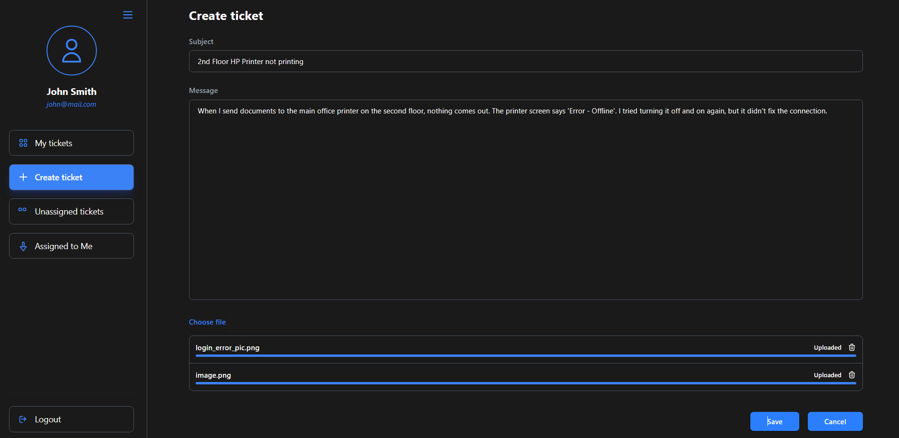

# Brennon

Helpdesk platform




## Project configuration

* Spring Boot 4 + Thymeleaf + Tailwind CSS + HTMX
* Gradle Frontend plugin + Webpack to bundle JS and CSS
* Spring Data Relational + PostgreSQL
* Local FS or S3 to store attachments

**NOTE:** `src/main/resources/static/dist/**` excluded from Git because it is generated by Webpack

**NOTE:** `src/main/resources/static/js/htmx.min.js` included instead of using CDN

## CI

* docker
  - [just backing services](ci/docker/docker-compose-backing-services.yml)
  - [full config including brennon service](ci/docker/docker-compose.yml)

### Github Actions

see [manifest](./.github/workflows/ci-default.yml)

To validate manifest use `actionLint`: `docker run --rm -v ./.github/workflows:/workflows rhysd/actionlint:latest -color /workflows/ci-default.yml`


## Observability

OTLP as a single protocol for metrics, traces and logs. Metrics and Traces are collected by `spring-boot-starter-opentelemetry`. 
Logging is handled separately with standalone collector due to alpha status of the official Logback/Log4j appenders.

### Logging

**Option 1: Open Telemetry appender**

[official guide](https://spring.io/blog/2025/11/18/opentelemetry-with-spring-boot)

```
implementation 'io.opentelemetry.instrumentation:opentelemetry-logback-appender-1.0:2.33.1-alpha'
implementation 'io.opentelemetry:opentelemetry-api-incubator:1.59.0-alpha'
```

Official Open Telemetry appenders are still in **alpha**. Manual dependency version alignment required.

**Option 2: open telemetry collector for logs (what is used)**

```yaml
  otel-collector:
    image: otel/opentelemetry-collector-contrib:latest
    container_name: otel-collector
    volumes:
      - ./otel-collector-config.yaml:/etc/otelcol-contrib/config.yaml
      - ./log:/var/log/brennon:ro
      - ./otel-data:/etc/otelcol-contrib/.data
    depends_on:
      - otel-lgtm
```

**Option 3: Open Telemetry Java agent**

Ignored intentionally as the intention is to stick with Spring Boot's starter.

### Metrics

Exported via OTLP Micrometer Registry.
OTLP is enabled by default. Logging (for metrics) is disabled by default.

```yaml
management:
  metrics:
    tags:
      application: ${spring.application.name}
    export:
      logging:
        enabled: false
        step: "5s"
  otlp:
    metrics:
      export:
        enabled: true
        url: "http://localhost:4318/v1/metrics"
        step: "15s"
```

### Traces

```yaml
management:
  opentelemetry:
    enabled: true
    tracing:
      export:
        schedule-delay: 5s
        timeout: 30s
        otlp:
          enabled: true
          endpoint: "http://localhost:4318/v1/traces"
```


## Things to note

* To achieve pure streaming file upload the default Spring's multipart data processing must be disabled (globally via properties or for specific endpoints via custom bean, see `MultipartConfig`). By default whanr using `@RequestParam` with `MultipartFile` the request body will be cached in temp files or memory (if small enough). Note that Spring Security can interfere and trigger request body to be cached, ex. when checking CSRF token passed via hidden form field, pass it via headers then. Here we use Uppy library for file upload and we do it via separate Ajax request to dedicated REST controller, CSRF token is passed in headers, see [scripts.html](src/main/resources/templates/ticket/fragments/scripts.html).

* DB indexes created for offset pagination. Deep pagination is not expected (users go down to 100th page). Sorting by `created` is supported, but considered much less common than by `updated`.

* [current-user-profile.html](src/main/resources/templates/core/current-user-profile.html) 
    provides a fragment showing user info (name, login, etc) which is used by main layout and
    loaded by HTMX. There is also a dedicated `CurrentUserProfileController` to serve the 
    fragment. Serving fragment via separate controllers allows to re-use them instead of 
    providing the same data (model parameters) in different controllers that use main layout.

* Parametrized Thymeleaf template example, see [sidebar-buttons.html](src/main/resources/templates/fragments/sidebar-buttons.html)

* Custom pages to handle errors. Ex. [404.html](src/main/resources/templates/core/common/404.html). 
    Configures via `ErrorPageRegistrar`, see `ErrorPageConfiguration` and `CustomErrorPageController`

* Form validation (`@NotBlank`, `@ModelAttribute`, etc) automatically uses error messages from `messages.properties`

* Custom converters for Spring Data JDBC, ex `BrennonUserConverters`.
* Spring Data JDBC does not support mapping to Integer for enums, [see here](https://github.com/spring-projects/spring-data-relational/issues/629).
* Spring Data JDBC does not have an option to load referenced aggregate (`AggregateReference<T,ID>`) and that is by design.

* Adding a reply implemented using HTMX, the page is then partially updated using area and fragments selectors. update different parts of the page based on backend response (success or error): use `HX-Retarget` header to override original `hx-target`, see `ticket-details.html`.

* Thymeleaf does not add CSRF fields into HTMX forms, we have to do it explicitly: `<input type="hidden" th:name="${_csrf.parameterName}" th:value="${_csrf.token}" />`, see `ticket-details.html`.

* `hx-on::before-request` to clear input field (remove error `<div>` added by Thymeleaf), see `ticket-details.html`

* Usage of HTMX OOB Swap to update multiple fragments by the same HTMX trigger (update "reply list" and "reply input form" in  cuncurrent update scenario). see [docs](./docs/HTMX.md)

* Usage of `HX-Request` header to have one endpoint serving full page template or a fragment depending on whether it is a HTMX request or not. 

* "In-place" editing aka "Click to edit", see [ticket-details.html](src/main/resources/templates/ticket/ticket-details.html) 

* Usage of `HX-Trigger` to fire custom client-side event and sync data across multiple forms on the same page.

* Custom `HxRefreshHeaderAuthenticationEntryPoint` to handle session expiration with HTMX requests (proper redirect to login).

* Native HTML validation, ex`inputmode="numeric" pattern="[1-9][0-9]*"` prevents HTMX from sending request with incorrect data

* ControllerAdvice with mixed responses: view name for regular requests and JSON for HTMX, see `TicketControllerAdvice`

* Usage of `{}` to isolate Thymeleaf script fragment loaded with HTMX in order to prevent "variable redeclaration" JS error. HTMX does not clear Browser environment on swap, so if loaded script creates global variable there will be conflicts. See `edit-ticket.html`

* see [HTMX.md](./docs/HTMX.md) for more HTMX-related info.

* `@DomainEvents` in Aggregate, published automatically by Spring Data

* File content validation with Apache Tika, see `FileContentValidator`

* Usage of `TicketRecord` as a lightweight projection of `Ticket` aggregate. That is because Spring Data JDBC does not support Single Query Loading for custom requests (Criteria API), so if we tried to select `List<Ticket>` there would be N+1 problem.

* `application-test.yaml` - profile-specific file to override specific properties. See also `build.gradle` where we explicitly set the profile.